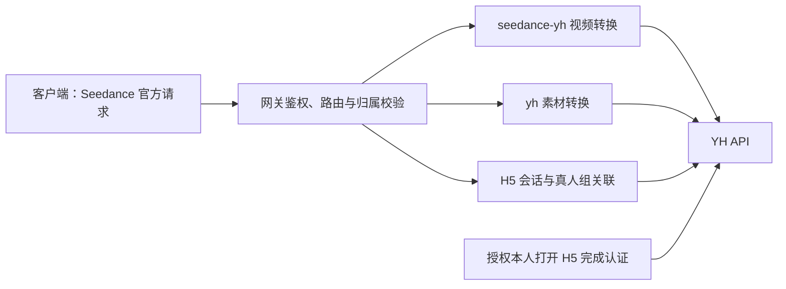

# YH 渠道 Seedance 视频、素材库与真人认证接入规划

- 日期：2026-11-03。
- 状态：核心适配已实现，进入联调验收；实现范围见 [接入指南](../guides/seedance_yh.md) 与 [本地验证](../reports/load/yh_integration_20261103.md)。规划阶段的非视频探测见 [2026-11-03 联调记录](../reports/live/yh_assets_probe_20261103.md)。以下保留设计依据，当前差异以本节为准。
- 2026-11-04：编译后完整网关已通过 [MySQL + 真实 YH 素材 300 并发创建与轮询](../reports/live/yh_assets_300_mysql_20261104.md)，300 个素材全部 Active。
- 随后完成 [180 次非生成接口实测](../reports/live/yh_non_generation_mysql_20261104.md)：普通素材与上传闭环通过；H5 本人认证失败且未重试，视频成功查询/下载缺少已有任务，If-Range 的上游行为存在限制。
- 最新 [300 并发与真实视频复测](../reports/live/yh_assets_video_300_20261104.md)：首轮创建 99 项上游限流，补建后 300 个全部 Active，两轮各 300 并发查询通过；修复 YH 列表 `total_count` 为当前页条数导致的截断。2.0 单素材、2.5 三素材各生成一个请求时长 5 秒的视频，2.5 的 1080p 已验收；`return_last_frame=true` 未取得末帧地址。

本轮已完成视频创建/查询、素材 Action、H5 本地关联、受保护下载及独立旧上传/批量入口。官方任务列表采用 SDK 契约和本地任务记录，不调用供应商账号级列表；旧异步句柄通过独立上传查询返回真实素材 ID，不作为素材别名直接使用。上传 Webhook 中继未实现；跨 Token 转移及 H5 回调继续保留待补契约。已完成两个真实视频，尚未完成人脸认证。
- 依据：[开发对接文档](../../开发对接文档.md)中的「视频生成接口（Seedance 2.0 / 2.5 官方格式）」「素材库接口」「真人素材（H5 人脸认证）」三个章节，以及本仓库当前实现。
- `YH` 暂按供应商域名 `www.yhapiplatform.com` 命名；不将后续「素材管理」「专业版」「OpenAPI 网关」章节混入本次协议。

## 1. 总体方案

客户端继续使用 Seedance 官方视频请求和方舟素材 Action 请求，网关内部转换为 YH 协议。推荐新增可配置视频 Profile `seedance-yh`，同时增加独立素材后端 `yh`，复用现有任务、归属、凭据、分页和计费设施。

官方协议覆盖的操作优先实现；批量上传、Webhook、分组转移等供应商扩展另列入口和语义。这些扩展仍在本次规划中，但不能伪装成官方 Action 已具备的能力。



配置建议：网关渠道 Base URL 使用 `https://www.yhapiplatform.com`，Profile 路径包含 `/v1`，避免文档 Base URL 自带 `/v1` 导致重复拼接；已有 URL 拼接规则及尾斜杠变体须用测试固定。出站使用供应商 API Key 的 Bearer 认证；入站仍使用本网关 Token。素材 Action 兼容不等于新增客户端 AK/SK 签名认证。

文档明确素材按供应商 Token 隔离。引用 `asset://` 生成视频时，视频与素材必须使用有权访问同一素材的供应商 Token。默认采用同一渠道、同一供应商 Key；独立素材凭据只是配置能力，不能据此承诺不同 Key、不同供应商之间可共享素材。新渠道首版不采用多 Key 随机轮换访问同一素材库。

## 2. 视频接口

### 2.1 接口映射

| 客户端入口 | YH 上游接口 | 实施方式 |
| --- | --- | --- |
| `POST /api/v3/contents/generations/tasks` | `POST /v1/video/generations` | 官方请求转换为 `model + prompt + metadata`；返回官方 `{ "id": "原始任务ID" }` |
| `GET /api/v3/contents/generations/tasks/{id}` | `GET /v1/video/generations/{id}` | 校验用户归属，固定原渠道及凭据，展开响应并转换官方状态 |
| 拟补官方任务列表 `GET /api/v3/contents/generations/tasks` | `GET /v1/video/tasks` | 客户端分页与筛选按官方列表契约实现；以本地自有任务为边界，上游列表仅用于限定范围的同步 |
| 现有 `GET /v1/videos/{id}/content` 扩展入口 | `GET /v1/videos/{id}/content` | 补齐原始任务 ID 解析、归属检查及 Range 下载；不重新提交生成任务 |

任务列表目前不在原生路由内，需要新增。官方列表的具体筛选字段和分页格式须在实现前核对官方契约；不能直接套用供应商的 `p/page_size` 或默认“当天”筛选。供应商一个 Token 可能承载多个网关用户，禁止直接透传整个上游列表，也不能据其 `user_id/token_id` 判定网关归属。未经过网关创建、没有本地归属的历史视频不会因列表同步自动导入。

现有通用视频提交/查询入口可共用此 Profile，但官方入口是主要验收对象。

### 2.2 请求转换

官方输入示例：

```json
{
  "model": "doubao-seedance-2-0-260128",
  "content": [{ "type": "text", "text": "果茶广告" }],
  "duration": -1,
  "resolution": "720p",
  "generate_audio": false,
  "seed": 0,
  "return_last_frame": false,
  "execution_expires_after": 3600
}
```

对应上游请求：

```json
{
  "model": "doubao-seedance-2-0-260128",
  "prompt": "果茶广告",
  "metadata": {
    "content": [{ "type": "text", "text": "果茶广告" }],
    "duration": -1,
    "resolution": "720p",
    "generate_audio": false,
    "seed": 0,
    "return_last_frame": false,
    "execution_expires_after": 3600
  }
}
```

转换规则：

1. `model` 使用现有模型映射结果；`content` 整体迁入 `metadata.content`，保留条目顺序、媒体类型、角色、URL、草稿引用和扩展子字段。
2. 已有非空文本条目按顺序提取为顶层 `prompt`，不重复追加或改写原始文本。若 `content` 没有非空文本、但客户端提供了非空 `prompt`，将该文本补入 `content` 并同步填充顶层 `prompt`。两处都没有文本时省略 `prompt`，不添加占位值。
3. **已确认决策（2026-11-03）：官方请求业务参数统一迁入 `metadata`，不限于供应商文档列出的字段。** `model` 保留顶层，顶层 `prompt` 按上一条提取；`content` 及其余参数，包括 `seed`、`return_last_frame`、`execution_expires_after`、`safety_identifier` 和未来扩展字段，均按原字段名放入 `metadata`。未提供的字段不补供应商默认值，显式 `false/0/-1` 必须保留。
4. 以原始 JSON 或 `RawMessage` 完成迁移，避免先压缩成通用 DTO 再丢失字段；保留原始类型、数值精度及嵌套结构。不因字段未列入供应商文档而过滤或拒绝透传，也不逐字段等待支持确认；上游若拒绝参数，按现有错误协议返回。
5. **已确认决策（2026-11-03）：暂不添加占位 `prompt`。** 供应商文档要求非空 `prompt`，但未说明当 `metadata.content` 存在时该字段是否仅用于校验。无文本媒体/草稿请求保留原始内容，省略 `prompt` 后交由上游校验；若上游拒绝，按现有错误协议返回，不补值重试。能否成功生成仍需联调验证。
6. 草稿升级保留 `content[].draft_task.id`。必须验证草稿属于当前网关用户、绑定原渠道/凭据，且与素材引用的渠道一致。正片请求不得由通用默认值逻辑补入 `duration/ratio/generate_audio`；客户端显式传入上游禁止的参数时明确报错。
7. 素材别名先通过归属层校验，再在内容迁移前解析，或让解析器显式支持 `metadata.content`。现有别名转换主要遍历顶层 `content`，不能假设嵌套后仍有效；本渠道也不应继承 TgxMaas 专用的项目字段注入。

文档列出的四个模型及 `doubao-seedance-2.5` 旧别名纳入配置候选。分辨率、时长、纯音频、工具和草稿等能力按模型分别验证，不把文档中的模型名称或功能说明当成真实可用性证据。

**已确认决策（2026-11-03）：2.5 支持 1080p，按此配置能力。** 该结论来自用户确认，覆盖文档模型表与草稿说明的冲突；本轮明确不生成视频，未做该分辨率的真实生成验证。

### 2.3 查询响应与结算

| YH 字段 | 官方响应或内部用途 |
| --- | --- |
| 创建响应 `task_id` | 创建响应 `id`；本地保留任务与原始 ID 映射 |
| 查询 `data.task_id` | 查询响应 `id`，并与请求任务做一致性校验 |
| `data.status` | `NOT_START/SUBMITTED/QUEUED → queued`，`IN_PROGRESS → running`，`SUCCESS → succeeded`，`FAILURE → failed` |
| `data.progress` | 内部进度；不因此认定任务已完成 |
| `data.data.content` | 官方 `content`，保留实际返回的视频/末帧等业务字段 |
| `data.data.usage` | 完整保留为官方 `usage`，同时提取 token 用量用于现有结算 |
| `data.data.duration/resolution/ratio/generate_audio/framespersecond` | 官方对应字段，保留实际时长与显式零值 |
| `data.fail_reason` | 只在失败状态作为错误来源；具体失败响应结构待补样例 |

现有转换器没有完整覆盖 `data.data.*` 的结果布局。增加本 Profile 的响应归一化，或明确扩展公共解析路径；不能只配到 `data.status`，却丢掉链接、用量和实际时长。未知状态应视为未识别响应，不能自动猜成成功或失败。

上游任务列表的 `fail_reason` 在 SUCCESS 时实际是视频地址，在 FAILURE 时才是错误。按状态区分，不能复用“非空 fail_reason 就失败”的判断，也不能把列表中的零用量作为结算依据。

文档说明：SUCCESS 后首次详情查询触发供应商按 token 扣费，扣费成功才交付视频，余额不足返回 402。因此：

- 后台轮询也可能触发供应商扣费，应计入正常生成交付流程；网关提交预扣和完成结算继续使用现有机制。
- **已确认决策（2026-11-03）：查询报错（包括 HTTP 402）按现有正常错误流程处理。** 保留上游 HTTP 状态及可用错误信息；轮询、客户端查询、超时、退款和终态保护沿用现有机制。
- 前台查询与后台轮询复用现有终态条件更新和结算逻辑。
- `duration=-1` 的请求值不能被预扣估算改写；完成后按真实用量和配置价格结算。文档没有给出可直接采用的完整模型价格，不硬编码供应商报价。
- 草稿与正片分别建任务和结算。素材管理不因供应商要求账户余额 ≥ 1 元而新增网关视频扣费。

本次不新增欠费等待状态、专用补查入口、查询恢复调度、超时豁免或结算补偿机制。

## 3. 素材库接口

### 3.1 官方 Action 映射

客户端继续调用 `POST /?Action=...&Version=2024-01-01`，请求使用 `Id/GroupId/Name/URL/AssetType` 等官方字段，响应使用 `ResponseMetadata/Result`。

| 官方 Action | YH 接口 | 差异处理 |
| --- | --- | --- |
| `CreateAssetGroup` | `POST /v1/assets/groups` | `Name → name`；实测创建直接返回整数 `data.group_id`，转为官方字符串 `Result.Id` |
| `ListAssetGroups` | `GET /v1/assets/groups`，按类型补真人组列表 | 合并确有需要的来源，先去重与归属过滤，再生成官方分页 |
| `GetAssetGroup` | 分组列表中按已授权 ID 定位 | 上游无详情接口，不能把“查列表”变成批量认领 |
| `UpdateAssetGroup` | `POST /v1/assets/groups/update` | `Id → id`、`Name → name`；Description、真人组可更新性待确认 |
| `DeleteAssetGroup` | `POST /v1/assets/groups/delete` 或真人组删除接口 | 根据已登记组类型分流；成功后撤销分组及已知子资源归属 |
| `CreateAsset` | 首选 `POST /v1/assets/async` | `URL → url`、`GroupId → group_id`、`AssetType → asset_type`；直接取得真实素材 ID |
| `GetAsset` | `POST /v1/assets/get` | `Id → id`；保留真实素材 ID，兼容有归属的旧包装 ID 和异步任务 ID |
| `ListAssets` | `POST /v1/assets/list` | 分页及可支持的筛选转换；过滤当前网关用户后重新计算总数/游标 |
| `UpdateAsset` | `POST /v1/assets/update` | 只确认支持名称更新；其他更新字段不能静默忽略 |
| `DeleteAsset` | `POST /v1/assets/delete` 或真人素材删除接口 | 根据素材所属组类型选择接口；删除成功才撤销本地记录 |

`CreateAsset` 采用新异步接口最接近官方异步审核语义，正常创建不再先返回 `task-*`。`Pending/Processing` 对外归一为 `Processing`，`Active/Failed` 对应保留；`Deleted` 的详情行为按真实响应确定，不假冒成可用素材。

供应商必须先建分组再上传。官方请求缺少 `GroupId` 时明确提示先创建分组，不自动将多个用户放进同一个默认分组。真人分组只能来自 H5 成功结果，不能由普通 `CreateAssetGroup` 冒充创建。

### 3.2 ID 与分组创建

- 新素材对外保持真实 `asset-*`，生成引用仍为 `asset://asset-*`。历史 `asset-yh-*`、`task-*` 与返回的 `real_id` 通过现有别名机制关联，不能跳过用户归属验证。
- 本轮旧异步上传的 `task-*` 可查询到真实 `asset-*`，但直接使用旧任务 ID 删除返回 404；修改、删除和视频引用应使用归属层已确认的真实 ID。相同图片在不同上传操作中可能返回同一真实 ID，登记归属和统计列表时按实际身份去重。
- 普通分组只有整数 `id`；真人分组同时有整数 `id` 与 `group-xxx`。建议统一把平台整数 ID 以字符串形式作为客户端 `Id/GroupId`，如 `"128"`；转换出站时再变为正整数，避免官方 Action 要求字符串而返回 JSON 数字。
- 真人 `group-xxx` 作为已验证的别名/元数据保存。上传和删除仍使用平台整数 ID，不能误传 `group-xxx`；客户端全生命周期所用 ID 不应在轮询后变化。
- 分组、素材、会话分别记录资源类型。整数 ID 在不同渠道/账号相同，不代表同一组；有歧义时拒绝，不任取一个渠道。
- 用户已明确分组接口细节不作为待确认前置项。实测创建响应为 `data.group_id`，直接登记该 ID；无需依赖同名列表查找或新增分组关联补偿流程。异常成功响应缺少 ID 时走现有错误处理，不自动重放创建。
- 分组列表实测使用整数 `id`；创建/更新返回的 `group_name` 可能带供应商用户及 Token 前缀，官方 `Name` 使用客户端展示名或列表中的 `name`，避免泄漏供应商账号标识。

### 3.3 分页、项目与错误

现有素材分页会按上游方法和既有后端推断分页形式；YH 的 POST 列表实际用 `page_number/page_size`，必须显式指定页码策略，不能误传上游游标。后续大于 100 个素材的实测发现 `data.total_count` 可仅表示当前页条数，不能作为扫描终止依据；改为扫描至短页／空页或已找到全部归属素材。普通分组返回 `data[]`，真人分组返回 `data.items[]`，分别解包并按规范化 ID 去重；本轮普通组列表可返回超过 100 条，真人组为空，未验证两类列表的重叠情况。

沿用“同一网关用户的 Token 共享素材，不同用户隔离”的规则；上游 Token 隔离作为额外约束。列表不会自动认领上游资源。项目字段在 YH 文档中未定义，初版只支持默认作用域；非默认 `ProjectName` 明确报不支持，不能仅保存一个无法在供应商侧兑现的隔离承诺。

HTTP 状态、业务失败和 `FaceMismatch` 等错误都保留可用语义；官方入口包装为 `ResponseMetadata.Error`。复用请求 ID、`Retry-After`、内部字段过滤和禁止自动重放逻辑。供应商响应必须先转换成归属层可识别的结构，再登记 ID、过滤列表和包装官方响应；仅在响应最后做 YAML 字段映射不足以保证归属正确。

## 4. 真人素材与 H5 认证

本地已有 TgxMaas、火山官方和有你有剧的 H5 适配，分别通过 [TgxMaas 资源配置](../../../relay/channel/configurable/profiles/seedance-tgxmaas.yaml)、[官方 Action 映射](../../../relay/channel/configurable/asset_backend.go)和 [有你有剧测试](../../../controller/youniyouju_asset_test.go)覆盖。它们依赖上游返回 `BytedToken/H5Link` 及后续查询/兑换接口，复用同一套会话归属和过期校验；现有文档中的 H5 验证主要是 Mock，并非真人认证成功的证据。YH 可复用这些公共部分，但不能直接套用上游 Token 兑换逻辑。本轮实测确认 YH 只返回 `h5_url/tip`。

### 4.1 官方入口适配

| 官方操作 | YH 接口 | 网关补充 |
| --- | --- | --- |
| `CreateVisualValidateSession` | `POST /v1/assets/real-person/auth/link` | 创建本地会话，转换 `h5_url → H5Link`，返回本地不透明 `BytedToken` |
| `GetVisualValidateResult` | `GET /v1/assets/real-person/groups` | 校验本地会话归属，寻找该会话准确对应的真人组，返回官方兼容结果 |
| `CreateAsset` / `GetAsset` / `ListAssets` | 普通素材接口 | 出站使用真人组整数 ID；保留审核中、通过及 `FaceMismatch` |
| `DeleteAsset` | `POST /v1/assets/real-person/assets/delete` | 根据已登记组类型路由 |
| `DeleteAssetGroup` | `POST /v1/assets/real-person/groups/delete` | 删除真人组并撤销关联资源 |

这里的 `BytedToken` 是网关兼容句柄，不是供应商返回的火山认证令牌；只用于本网关查询认证结果。文档仅返回 `h5_url`，不能从链接猜测或提取一个未定义的上游 Token。

### 4.2 会话关联流程

1. 创建会话时生成高熵查询句柄及独立关联名称，持久化句柄摘要、网关用户、原渠道/素材库身份、关联名称、创建时间和过期信息；复用现有状态表，敏感链接不写普通日志。
2. YH 文档要求 `artist_name` 唯一且最多 32 字符，但本轮 24 字符名称被 HTTP 500 拒绝并提示名称过长，8 字符名称成功；供应商可能将账号前缀也计入上游组名限制，具体原因尚未确认。关联名采用短随机值，并在本地确保唯一；仅当上游明确返回重名拒绝时重新生成，不能直接使用可能超长的展示名。官方客户端不新增必填供应商字段，展示名/描述另行保存。认证成功后的名称回传和组关联仍待真人联调验证。
3. 调用上游获取链接，返回 `H5Link` 和本地 `BytedToken`。授权本人打开手机 H5，在文档规定的 120 秒内完成认证。
4. 查询结果时，只到会话绑定的原渠道取真人组；按保存的唯一关联名称及创建时间等辅助信息匹配，禁止选取最新组、列表第一项或仅凭同名展示名认领。
5. 找到唯一匹配组后，原子登记用户归属、整数 ID、上游组别名和真人组类型，并完成会话。重复查询返回同一组；多个候选则返回关联冲突，不自动选择。
6. 暂时查不到不能立即判定认证失败。文档提示存在 1～2 秒可见延迟；分别记录链接 120 秒有效期与本地结果查询保留期，允许有界延迟查询。结果查询保留期可沿用本地会话机制，但不能因此把 H5 有效期宣称为 30 分钟。过期无结果返回明确状态，不自动创建新链接。

官方 `CallbackURL` 与认证状态/失败响应契约需在实施前补核。YH 未提供自定义认证完成回调，也没有失败详情接口。计划以结果轮询为基础；若必须兑现官方 H5 跳转/回调语义，需要供应商支持或另设明确的网关适配流程。确认前对无法兑现的回调要求明确报错，不默默忽略，也不以上传 Webhook 代替 H5 回调。

## 5. 供应商扩展接口覆盖

以下均属于用户指定章节；官方核心闭环完成后继续纳入实现，不在官方接口中隐式发明字段或 Action。

| 文档能力 | 规划处理 |
| --- | --- |
| `POST /v1/assets` 单条同步、旧异步 | 提供明确标注的供应商兼容扩展；同步保留审核等待语义，旧异步登记任务句柄到真实 ID 的关联 |
| `POST /v1/assets/async` | 官方 `CreateAsset` 内部默认使用；扩展入口可直接复用 |
| `POST /v1/assets` 的 `urls` 批量上传 | 扩展接口支持最多 50 条；登记批次及逐项归属，保留部分失败，不伪装成单个官方素材 |
| `POST /v1/assets/batch/get` | 按批次归属查询，逐项合并结果/真实 ID；不允许按任意供应商批次号代查 |
| 上传 Webhook | 仅用于文档确认支持的旧 async/批量上传；网关中继验签、按任务 ID 幂等登记归属，再投递用户显式配置的回调，失败可轮询补偿 |
| `GET /v1/assets/{id}/content` | 新增带素材归属检查的内容入口，复用受保护的下载组件，支持 Range |
| `POST /v1/assets/groups/transfer` | 无官方等价操作；在明确目标供应商 Token 的可验证配置后作为扩展实现，见下文 |
| 真人组列表与专用删除入口 | 官方核心已使用这些上游操作；如开放原路径，也经过同一会话/归属机制，不能原样泄漏整账号列表 |

批量实测：两个有效 URL 均进入 Active；混合一个有效和一个无效 URL 时两项均 Failed。查询响应未返回批次级状态，应聚合 `items[].status`；处理中各项 `id` 可能共用批次任务 ID，按批次加条目关联，真实素材 ID 回填后再登记素材别名，不能提前把重复任务 ID 当作独立素材。

Webhook 不能直接绕过网关交付新 ID，否则素材尚未登记，后续引用将失去可靠归属来源。供应商说明仅在传 `callback_secret` 时签名，网关中继应主动设置内部签名密钥，使用原始字节验签，并处理回调早于创建响应、重复回调、部分失败和轮询竞态。需要投递给客户端时用客户端约定的密钥重新签名。新 `/assets/async` 文档未列回调参数，不默认宣称支持。

分组转移的 `token_id` 是供应商 Token ID，不是本网关 Token ID。目标须来自经验证的同一供应商账户配置，资源仍属于当前网关用户；上游成功后才迁移本地渠道/素材库绑定，并处理子素材、异步句柄和并发引用。供应商尚未说明真人组、未完成上传、既有视频任务在转移后的行为，也未提供目标 Token 校验接口；这些确认前不开放裸 `token_id` 透传，保留为明确待完成的扩展项。

扩展路由先核查现有 `/v1/assets*`、`/v1/video*` 别名冲突，共用资源分发，必要时使用供应商命名空间。客户端使用官方入口时不感知这些供应商路径。

内容下载复用现有保护机制，但当前视频代理只接受 HTTP 200，尚未透传 Range。需要支持 `Range/If-Range`、206、416、`Content-Range/Accept-Ranges` 和安全响应头，并按用户授权处理缓存。浏览器无需 Bearer 的访问若确有需求，再提供受限时效链接；不因供应商原地址可裸访问就开放网关匿名资源读取。

## 6. 代码落点与实施顺序

### 阶段一：视频提交、查询闭环

- 新增 `relay/channel/configurable/profiles/seedance-yh.yaml`。
- 在 [视频适配器](../../../relay/channel/configurable/task_adaptor.go)的原生请求发送前加入按 Profile 启用的转换，补充双层响应归一化；保留其他 Profile 行为。
- 在 [Seedance 公共能力](../../../relay/common/seedance.go)中登记 Profile，确保无文本输入识别、状态/ID 校验及终态保护走正确路径。
- 复用 [任务轮询](../../../service/task_polling.go)及现有错误、超时和结算流程，覆盖 HTTP 402 等错误返回、用量提取、草稿归属与并发查询回归；必要的共享改动限定到明确需求。
- 先验收文本和图片引用，再补供应商已确认语义的纯音频、草稿升级、视频编辑/延长。

### 阶段二：普通素材官方 Action

- 在 [素材后端注册](../../../relay/channel/configurable/asset_backend.go)加入 `yh`；新增独立的 YH 请求/响应转换文件。
- 为 [资源执行链路](../../../controller/configurable_resource.go)增加适当的供应商归一化/多步操作接点，保证转换发生在归属登记与列表过滤之前。
- 对接 [归属校验](../../../controller/asset_access.go)、[分页](../../../controller/asset_list.go)、[官方响应](../../../controller/asset_official_response.go)及 [视频素材引用](../../../controller/asset_video_access.go)。
- 优先复用 [状态存储](../../../model/configurable_resource_state.go)和 [素材绑定](../../../model/asset_binding.go)，扩展元数据保存组类型、关联名称与会话结果；需要新增结构时再评估迁移，保持 SQLite/MySQL/PostgreSQL 兼容。

### 阶段三：H5 与真人素材闭环

- 实现会话创建、唯一关联、结果查询、有效期及原子绑定，复用素材上传和视频引用。
- 验收多用户同一上游 Key、并发认证、重复查询、可见延迟、过期、真人专用删除和 `FaceMismatch`。
- 上游若无法提供可靠关联或所需回调语义，单独保留该能力待补协议，不以列表推测结果来宣告完成。

### 阶段四：扩展与接入体验

- 补任务列表、视频/素材内容下载、批量上传、回调和具备明确转移语义后的分组转移。
- 在 [视频路由](../../../router/video-router.go)中添加缺少的入口，检查重复注册和同路径多 Profile 分发。
- 渠道编辑增加 Profile/素材后端选项和必要提示，补默认主题及仍维护入口的翻译；实现前端时遵守对应技能和项目约定。
- 更新接入指南、模型能力表和测试记录，逐项标记已实现、Mock 已验证、真实上游已验证及待供应商确认。

## 7. 待补齐的供应商契约

这些问题不妨碍先实现已有明确协议的部分，但影响完整兼容的验收：

| 问题 | 影响 |
| --- | --- |
| `metadata.content` 存在时 `prompt` 是否参与模型输入；无文本、草稿正片的合法请求示例 | 验证省略 `prompt` 的实际行为；按已确认决策不添加占位值 |
| H5 是否有未列出的会话 ID、结果查询、失败状态和 CallbackURL 支持；关联名称是否原样返回 | 决定官方真人认证能兼容到什么程度 |
| 视频失败、402、素材失败/删除、批次部分失败的完整 HTTP 与 JSON 样例 | 素材状态、删除、批次失败及不存在的视频任务错误已取得实测样例；生成中/失败/402 未触发，后续联调补齐，沿用既定错误处理 |
| 新异步上传是否支持回调；跨 Token 转移后的 ID/访问权及进行中任务行为 | 完成扩展能力的契约与一致性处理 |

## 8. 验收清单

| 场景 | 必须验证 |
| --- | --- |
| 官方视频请求 | 上游捕获完整 `metadata.content` 及其余官方参数；文档未列出的字段和未来扩展字段也迁入 `metadata`，包括 `seed=0`、`return_last_frame=false`、`execution_expires_after`；原始类型、数值精度、媒体角色和顺序保留；省略字段不补值 |
| 无文本媒体/草稿请求 | 出站省略 `prompt`，不注入占位文本；上游拒绝时正确返回错误，不补值重试 |
| 查询结果 | 原始 ID 可查，固定原渠道，双层 content/完整 usage 正确展开，未知状态不误判 |
| 查询异常与并发 | HTTP 402/429/5xx 按现有错误流程处理，不构造成功结果；轮询、超时、退款和并发结算沿用现有机制 |
| 草稿升级 | 所有者及原渠道验证，不注入禁止参数，草稿和正片分别结算 |
| 普通素材 | 官方 Action 完整 CRUD，分组 ID 数字/字符串转换，异步审核及旧别名关联 |
| 用户隔离 | 同用户多 Token 共享；他人 ID/会话/批次被拒绝；跨账号同整数 ID 不串组 |
| 列表 | 页码/游标转换正确；过滤后 total 准确；普通组/真人组去重；不认领陌生资源 |
| H5 | 120 秒链接与查询保留期分离，唯一关联、延迟可见、重复/并发查询及过期处理正确 |
| 真人素材 | 正确使用整数 group_id；同人审核通过与 FaceMismatch 区分；专用删除撤销引用 |
| 扩展 | 批次部分失败、回调签名/幂等/竞态、转移一致性、下载 206/416 与归属检查 |
| 回归 | 官方直连、TgxMaas、Ark-compatible、现有通用视频接口及素材错误包装不受影响 |

先通过本地模拟供应商及公开路由集成测试验证转换和状态机，再使用测试渠道做真实小额视频闭环；H5 需要授权本人参与。Mock 成功只能证明网关行为，不能替代模型支持性、供应商扣费和真人认证的真实验证。
